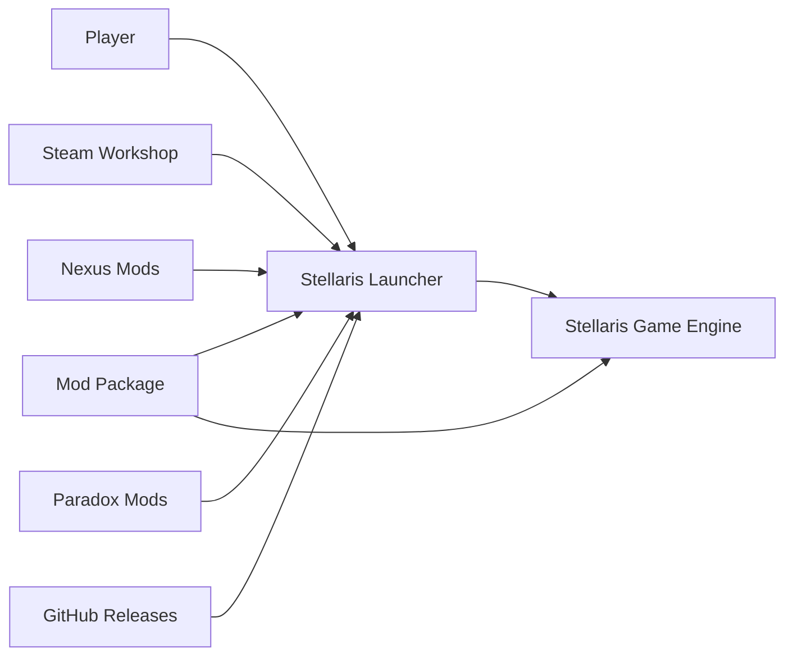
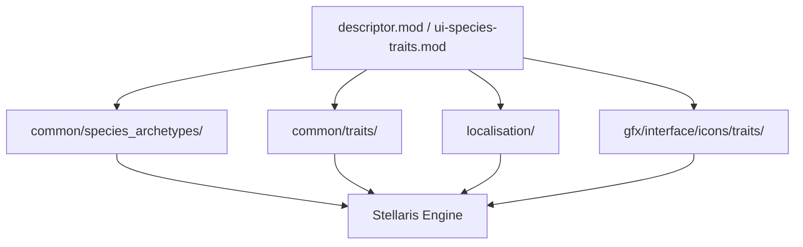
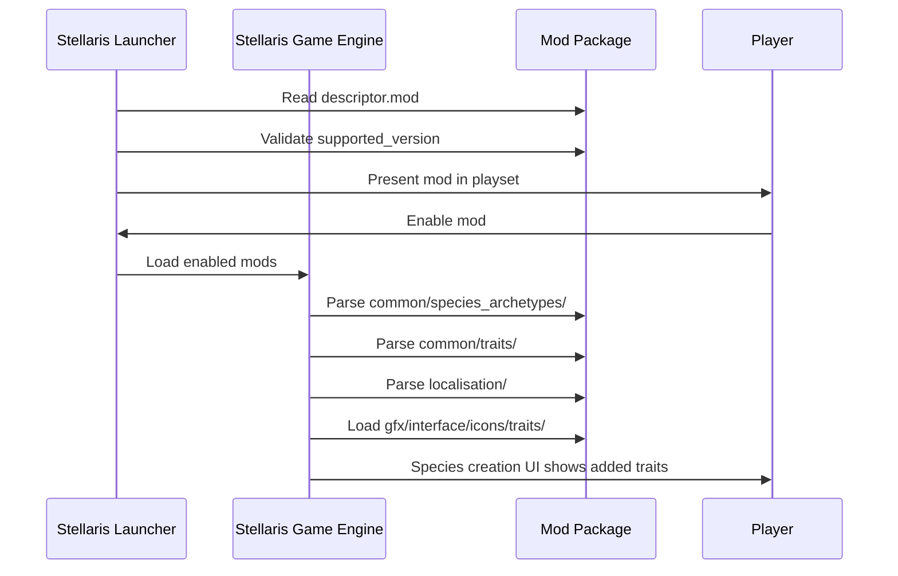
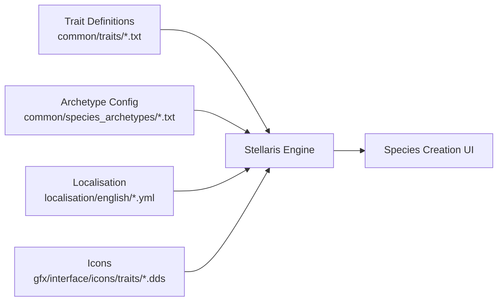

# Universum Infinitum - Species Traits Architecture

This document describes the current architecture of the Universum Infinitum - Species Traits Stellaris mod. It covers the mod structure, data organisation, integration with Stellaris, and the content delivery model.

## 📑 Table of Contents

- [Purpose](#purpose)
- [System Context](#system-context)
- [Architectural Style](#architectural-style)
- [Runtime Flow](#runtime-flow)
- [Architectural Areas](#architectural-areas)
- [Data Architecture](#data-architecture)
- [Interfaces and Integrations](#interfaces-and-integrations)
- [Dependency Direction and Rules](#dependency-direction-and-rules)
- [External Dependencies](#external-dependencies)
- [Deployment and Operations](#deployment-and-operations)
- [Compatibility Contracts](#compatibility-contracts)
- [Testing and Verification](#testing-and-verification)
- [Design Constraints](#design-constraints)
- [Extension Points](#extension-points)
- [Source Map](#source-map)
- [Related Documentation](#related-documentation)

## 🎯 Purpose

This document defines the architectural boundaries of the Universum Infinitum - Species Traits mod for Stellaris. It describes how the mod organises its species trait definitions, archetype modifications, localisation, and icon assets; how these integrate with the Stellaris game engine at load time; and the constraints governing content additions and distribution. The intended audience is maintainers and contributors who need to understand the mod structure to add traits, tiers, or localisation safely.

## 🌐 System Context

The mod is a static data package consumed by the Stellaris launcher and game engine. It has no runtime process of its own.

The principal external boundaries are:
- **Stellaris Launcher:** Reads `descriptor.mod` / `ui-species-traits.mod` to register the mod, validate `supported_version`, and present it in the playset UI.
- **Stellaris Game Engine:** Loads `common/species_archetypes/`, `common/traits/`, `localisation/`, and `gfx/interface/icons/traits/` at startup to extend species creation.
- **Distribution Platforms (Steam Workshop, Nexus Mods, Paradox Mods, GitHub Releases):** Host the packaged mod archives; the mod declares no platform-specific behaviour.

## 🏗️ Architectural Style

The mod follows a **declarative data-driven plugin** architecture. All content is expressed as static Clausewitz script files (`.txt`), YAML localisation (`.yml`), and DDS image assets (`.dds`). The Stellaris engine interprets these at load time; the mod supplies no executable code, scripts, or runtime services. Consequences:
- Ownership is file-based: each trait, archetype, localisation key, and icon is an independent asset.
- Changes are additive: new traits or tiers are new files or new entries in existing files; no migration logic is required.
- Compatibility is declared via `supported_version` in the mod descriptors; the engine enforces version gating.

The principal architecture boundaries are:
- **Descriptor Layer:** `descriptor.mod` and `ui-species-traits.mod` — declare mod identity, path, tags, and `supported_version`.
- **Archetype Layer:** `common/species_archetypes/00_species_archetypes.txt` — adjusts trait points and max traits for BIOLOGICAL, ROBOT, MACHINE, PRESAPIENT, LITHOID, OTHER archetypes.
- **Trait Definition Layer:** `common/traits/ui-traits_species.txt` and `ui-traits_species_newtiers.txt` — define 58 custom traits and additional Very/Extremely tiers for vanilla trait families.
- **Localisation Layer:** `localisation/english/ui-species-traits_l_english.yml` and `ui-species-traits_newtiers_l_english.yml` — provide English names and descriptions for all traits.
- **Asset Layer:** `gfx/interface/icons/traits/*.dds` — dedicated icons for each trait, referenced by `icon = "GFX_trait_..."` in trait definitions.

## 🔄 Runtime Flow

The principal runtime sequence is:
1. Launcher reads `descriptor.mod` / `ui-species-traits.mod` and validates `supported_version="v4.4.*"`.
2. Player enables the mod in the active playset.
3. Game engine starts and loads all enabled mod directories.
4. Engine parses species archetype adjustments (trait points, max traits per archetype).
5. Engine parses trait definitions (cost, category, modifiers, opposites, allowed archetypes, icons).
6. Engine loads localisation strings for trait names and descriptions.
7. Engine loads trait icons from `gfx/interface/icons/traits/`.
8. Species creation UI presents the additional traits subject to trait points and trait-count limits.

## 🗂️ Architectural Areas

### Descriptor Area

Paths:
- `ui-species-traits.mod`
- `ui-species-traits/descriptor.mod`

Responsibilities:
- Declare mod metadata: name, path, tags, `supported_version`.
- Provide the entry point for the launcher and engine.

Boundary rules:
- Must remain at repository root (`ui-species-traits.mod`) and mod root (`ui-species-traits/descriptor.mod`).
- `supported_version` must match the target Stellaris version branch.
- No executable logic; purely declarative.

### Archetype Area

Paths:
- `ui-species-traits/common/species_archetypes/00_species_archetypes.txt`

Responsibilities:
- Define trait points and maximum selectable traits for each species archetype (BIOLOGICAL, ROBOT, MACHINE, PRESAPIENT, LITHOID, OTHER).
- Increase limits: biological/machine to 7 traits and 2/1 trait points; robot to 6 traits and 0 trait points.

Boundary rules:
- Uses variable references (`@species_trait_points`, `@species_max_traits`, etc.) for maintainability.
- `LITHOID` inherits from `BIOLOGICAL` via `inherit_trait_points_from`.
- `PRESAPIENT` and `OTHER` disable modifiers via `uses_modifiers = no`.

### Trait Definition Area

Paths:
- `ui-species-traits/common/traits/ui-traits_species.txt`
- `ui-species-traits/common/traits/ui-traits_species_newtiers.txt`

Responsibilities:
- Define 58 custom species traits (positive and negative) covering combat, population, science, economy, habitability, and lifespan.
- Extend vanilla trait families with Very and Extremely tiers using a documented scaling policy (x11/6 effects, x3 cost for Very; +20% effects for Extremely).
- Each trait specifies: `cost`, `category`, `opposites`, `allowed_archetypes`, `tags`, `modifier` block, `icon`, `slave_cost`, `ai_weight`.

Boundary rules:
- Trait IDs follow the `ui_trait_*` prefix for custom traits; vanilla-extended tiers use `ui_trait_very_*` and `ui_trait_extremely_*`.
- `opposites` lists mutually exclusive trait IDs (vanilla and custom).
- `allowed_archetypes` restricts to `BIOLOGICAL`, `LITHOID`, or both.
- `modifier` blocks use Stellaris static modifiers (e.g., `planet_jobs_food_produces_mult`, `pop_environment_tolerance`).
- `icon` references DDS files in `gfx/interface/icons/traits/`.
- Scaling policy documented in file headers; not enforced by tooling.

### Localisation Area

Paths:
- `ui-species-traits/localisation/english/ui-species-traits_l_english.yml`
- `ui-species-traits/localisation/english/ui-species-traits_newtiers_l_english.yml`

Responsibilities:
- Provide English display names (`ui_trait_*:0`) and descriptions (`ui_trait_*_desc:0`) for all traits.
- Use `§L...§!` formatting for in-game description styling.

Boundary rules:
- File encoding: UTF-8 with BOM (Stellaris requirement).
- Keys must exactly match trait IDs from trait definition files.
- Only English (`l_english`) is currently provided.

### Asset Area

Paths:
- `ui-species-traits/gfx/interface/icons/traits/*.dds` (58 files)

Responsibilities:
- Provide a dedicated icon for each custom trait and tier.
- Referenced by `icon = "GFX_trait_..."` in trait definitions.

Boundary rules:
- Format: DDS (DirectDraw Surface), required by Stellaris.
- Naming: `trait_<trait_id>.dds` or `ui_trait_<trait_id>.dds` matching the `icon` reference.
- No subdirectories; all icons reside directly in `traits/`.

## 💾 Data Architecture

The mod owns no persistent state at runtime. All data is static configuration loaded by the engine at startup.

| Data or Store | Owner | Representation and Storage | Lifecycle or Consistency |
|---------------|-------|----------------------------|--------------------------|
| Trait definitions | Trait Definition Area | Clausewitz script (`.txt`) in `common/traits/` | Static; loaded once at game start |
| Archetype config | Archetype Area | Clausewitz script (`.txt`) in `common/species_archetypes/` | Static; loaded once at game start |
| Localisation strings | Localisation Area | YAML (`.yml`) in `localisation/english/` | Static; loaded once at game start |
| Trait icons | Asset Area | DDS images in `gfx/interface/icons/traits/` | Static; loaded once at game start |
| Mod descriptors | Descriptor Area | Clausewitz script (`.mod`) at root and mod root | Static; read by launcher and engine |

## 🔌 Interfaces and Integrations

| Interface | Direction | Contract | Owner | Failure Semantics |
|-----------|-----------|----------|-------|-------------------|
| Mod descriptor | Engine → Mod | `descriptor.mod` / `ui-species-traits.mod` with `name`, `path`, `tags`, `supported_version` | Descriptor Area | Mod not listed or version mismatch → mod disabled |
| Species archetypes | Engine → Mod | `common/species_archetypes/*.txt` defining trait points and max traits per archetype | Archetype Area | Parse error → archetype defaults used |
| Trait definitions | Engine → Mod | `common/traits/*.txt` with `cost`, `category`, `opposites`, `allowed_archetypes`, `modifier`, `icon` | Trait Definition Area | Parse error → trait omitted; missing icon → placeholder |
| Localisation | Engine → Mod | `localisation/english/*.yml` with `l_english:` keys matching trait IDs | Localisation Area | Missing key → raw ID displayed |
| Trait icons | Engine → Mod | `gfx/interface/icons/traits/*.dds` referenced by `icon = "GFX_..."` | Asset Area | Missing file → placeholder icon |

## 🔗 Dependency Direction and Rules

- **Descriptor → All Areas:** The mod descriptor is the root; it must exist for the mod to be recognised.
- **Trait Definitions → Localisation:** Every trait ID in `common/traits/` must have a corresponding key in `localisation/english/`.
- **Trait Definitions → Assets:** Every trait with an `icon` reference must have a matching `.dds` file in `gfx/interface/icons/traits/`.
- **Archetype Area → Trait Definitions:** Archetype trait-point and max-trait limits constrain which traits are selectable but do not reference specific trait IDs.
- **No circular dependencies:** All dependencies flow from engine to static mod files; the mod has no internal runtime dependencies.
- **Prohibited coupling:** Trait definitions must not reference other mod files by path; only by trait ID in `opposites` and `allowed_archetypes`.

## 📦 External Dependencies

| Dependency | Version | Scope | Purpose |
|------------|---------|-------|---------|
| Stellaris Game Engine | `4.4.*` | Runtime | Parses all mod files; provides species creation UI |
| Clausewitz Script Parser | Built into Stellaris | Build/Load | Interprets `.txt` and `.mod` files |
| YAML Parser | Built into Stellaris | Build/Load | Interprets `.yml` localisation files |
| DDS Image Loader | Built into Stellaris | Build/Load | Loads `.dds` trait icons |

No third-party libraries, package managers, or build tools are required. The mod is a pure data package.

## 🚢 Deployment and Operations

- **Process topology:** None. The mod is a static archive extracted to the Stellaris mod directory.
- **Deployment model:** Manual installation (extract archive to mod directory) or platform-managed (Steam Workshop, Nexus Mods, Paradox Mods subscribe/install).
- **Persistent state:** None owned by the mod. Stellaris manages playset enablement and save-game trait selections.
- **Scaling assumptions:** Single-player and multiplayer compatible; no server component.
- **Operational consequences:** Mod updates require re-extraction or platform update; save games with custom traits require the mod to remain enabled.

## 📜 Compatibility Contracts

| Contract | Owner | Invariant | Verification Method | Change Policy |
|----------|-------|-----------|---------------------|---------------|
| `supported_version` | Descriptor Area | Must match target Stellaris version branch | Launcher validation at mod load | Update on new Stellaris major version |
| Trait ID ↔ Localisation key | Trait Definition Area / Localisation Area | Every `ui_trait_*` ID has `ui_trait_*:0` and `ui_trait_*_desc:0` in `.yml` | Manual review; engine shows raw ID if missing | Add localisation when adding traits |
| Trait ID ↔ Icon file | Trait Definition Area / Asset Area | Every `icon = "GFX_trait_..."` has matching `.dds` in `gfx/interface/icons/traits/` | Manual review; engine shows placeholder if missing | Add icon when adding traits |
| Trait scaling policy | Trait Definition Area | Very tiers: x11/6 effects, x3 cost; Extremely: +20% effects, cost x4 base | Documented in file headers; not automated | Policy changes require rebalancing all tiers |
| Archetype limits | Archetype Area | BIOLOGICAL/MACHINE: 7 traits, 2/1 points; ROBOT: 6 traits, 0 points | Engine enforces at species creation | Adjust variables in `00_species_archetypes.txt` |

## 🧪 Testing and Verification

- **No automated test suite exists.** Verification is manual:
  1. Install mod locally (extract to Stellaris mod directory).
  2. Enable in launcher.
  3. Start Stellaris and open species creation.
  4. Verify all 58 custom traits appear with correct names, descriptions, icons, costs, and modifiers.
  5. Verify Very/Extremely tiers for vanilla families appear and scale correctly.
  6. Verify archetype trait-point and max-trait limits apply (biological/machine 7 traits, robot 6 traits).
  7. Verify no script errors in `error.log` or console.
- **Material coverage gaps:** No automated regression testing; no CI pipeline for content validation.
- **Prohibitions:** Do not commit untested trait definitions; do not modify vanilla trait IDs in `opposites` without verifying they exist in the target Stellaris version.

## ⚙️ Design Constraints

- **Stellaris version coupling:** `supported_version="v4.4.*"` ties the mod to the 4.4.x branch. New major versions (e.g., 4.5) require descriptor updates and potential trait rebalancing.
- **Clausewitz script limitations:** No variables, loops, or functions in trait definitions; all values are literal.
- **Localisation single-language:** Only English provided; adding languages requires new `localisation/<locale>/` directories and `.yml` files.
- **Icon format lock-in:** DDS is mandatory; no runtime conversion from PNG or other formats.
- **Trait count limits:** Engine enforces `species_max_traits` per archetype; cannot be exceeded by mod configuration alone.
- **No runtime modification:** Traits cannot be added, removed, or modified during gameplay; all changes require game restart.
- **Scaling policy not enforced:** The documented x11/6 and +20% scaling is a design convention; the engine does not validate it.

## 🔧 Extension Points

- **New custom traits:** Add entries to `ui-traits_species.txt` (or a new `.txt` in `common/traits/`), add localisation keys, add icon `.dds`.
- **New tier extensions for vanilla traits:** Add entries to `ui-traits_species_newtiers.txt` following the documented scaling policy.
- **Additional archetypes:** Extend `00_species_archetypes.txt` with new archetype blocks (rarely needed).
- **New languages:** Create `localisation/<locale>/` with translated `.yml` files.
- **Icon replacements:** Replace `.dds` files in `gfx/interface/icons/traits/` keeping the same filename.

Integration location: All extensions are additive file placements within the existing directory structure; no registration or composition root modification is required.

## 🗺️ Source Map

| Area | Repository-Relative Paths |
|------|---------------------------|
| Descriptor | `ui-species-traits.mod`, `ui-species-traits/descriptor.mod` |
| Archetype | `ui-species-traits/common/species_archetypes/00_species_archetypes.txt` |
| Trait Definitions | `ui-species-traits/common/traits/ui-traits_species.txt`, `ui-species-traits/common/traits/ui-traits_species_newtiers.txt` |
| Localisation | `ui-species-traits/localisation/english/ui-species-traits_l_english.yml`, `ui-species-traits/localisation/english/ui-species-traits_newtiers_l_english.yml` |
| Assets | `ui-species-traits/gfx/interface/icons/traits/*.dds` |
| Source Assets | `src/trait.xcf` (GIMP source for icons) |
| Distribution | `.github/workflows/nexus-mods.yml`, `.github/workflows/steam-workshop.yml` |

## 📚 Related Documentation

| Document | Scope |
|----------|-------|
| [README.md](./README.md) | Project overview, installation, capabilities, compatibility |
| [CONTRIBUTING.md](./CONTRIBUTING.md) | Contribution guidelines, development setup, code style |
| [CODE_OF_CONDUCT.md](./CODE_OF_CONDUCT.md) | Community conduct standards |
| [SECURITY.md](./SECURITY.md) | Vulnerability reporting and disclosure policy |
| [PRIVACY.md](./PRIVACY.md) | Data handling and privacy statement |
| [Trait Catalogue (Wiki)](https://github.com/hmlendea/stellaris-ui-species-traits/wiki/Traits) | Detailed trait list with effects and costs |