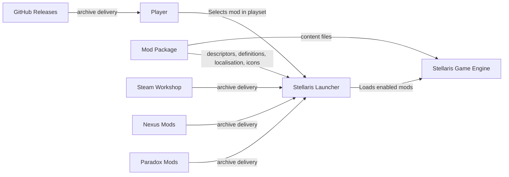
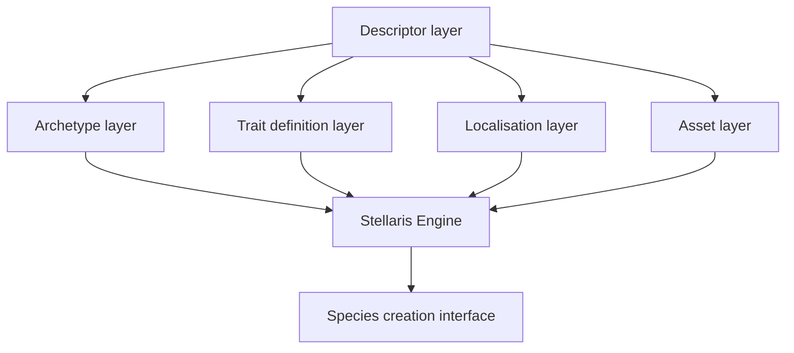
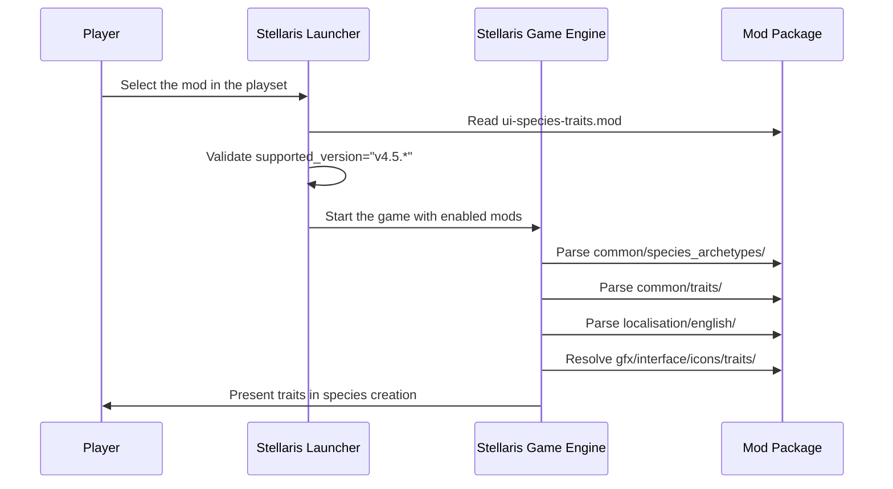
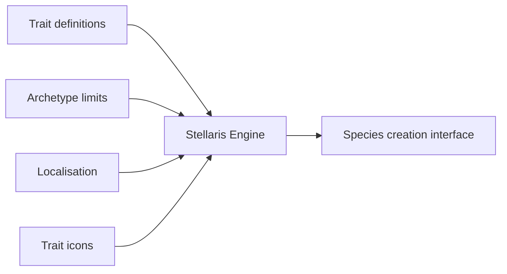
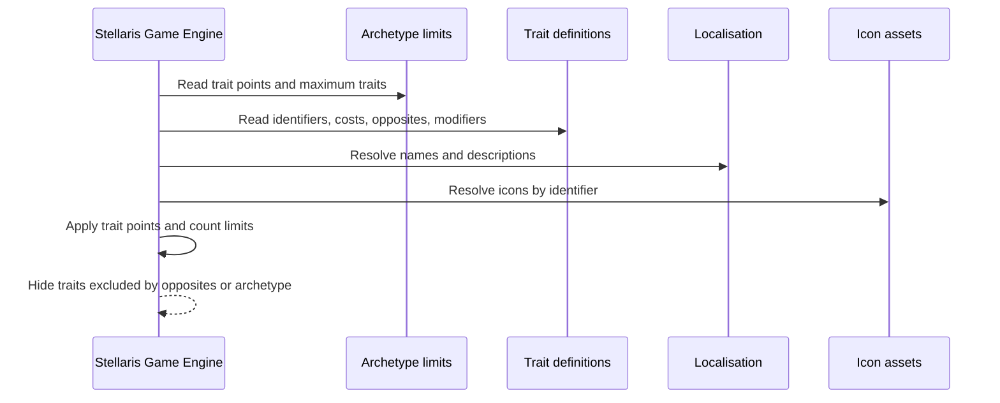
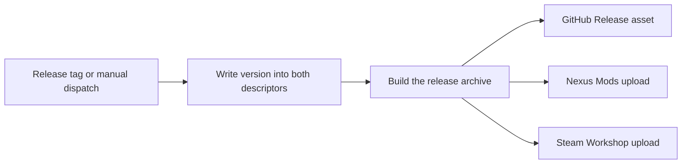
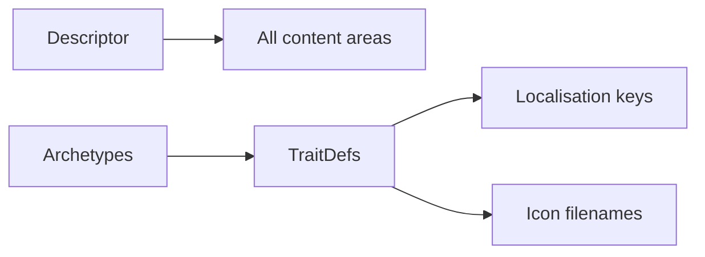

# Universum Infinitum - Species Traits Architecture

This document describes the verified current architecture of the Universum Infinitum - Species Traits Stellaris mod. It covers the mod package boundaries, data organisation, integration with the Stellaris engine, content delivery, and the constraints governing change. Target architecture and planned evolution are out of scope.

## 📑 Table of Contents

- [Purpose](#-purpose)
- [System Context](#-system-context)
- [Architectural Style](#-architectural-style)
- [Runtime Process](#-runtime-process)
- [Components](#-components)
- [Architectural Areas](#-architectural-areas)
  - [Descriptor Area](#descriptor-area)
  - [Archetype Area](#archetype-area)
  - [Trait Definition Area](#trait-definition-area)
  - [Localisation Area](#localisation-area)
  - [Asset Area](#asset-area)
- [Data Architecture](#-data-architecture)
- [Interfaces and Integrations](#-interfaces-and-integrations)
- [Key Processes](#-key-processes)
  - [Trait Resolution in Species Creation](#trait-resolution-in-species-creation)
  - [Release Packaging](#release-packaging)
- [Tier Scaling Policy](#-tier-scaling-policy)
- [Cross-Cutting Concerns](#-cross-cutting-concerns)
  - [Security and Privacy](#security-and-privacy)
  - [Error Handling](#error-handling)
  - [Observability](#observability)
  - [Configuration](#configuration)
  - [Concurrency and Resource Use](#concurrency-and-resource-use)
- [Dependency Direction and Rules](#-dependency-direction-and-rules)
- [External Dependencies](#-external-dependencies)
- [Deployment and Operations](#-deployment-and-operations)
- [Compatibility Contracts](#-compatibility-contracts)
- [Testing and Verification](#-testing-and-verification)
- [Design Constraints](#-design-constraints)
- [Extension Points](#-extension-points)
  - [Custom Traits](#custom-traits)
  - [Vanilla Tier Extensions](#vanilla-tier-extensions)
  - [Additional Languages](#additional-languages)
- [Evolution and Migration](#-evolution-and-migration)
  - [Current State](#current-state)
  - [Target State](#target-state)
  - [Transition](#transition)
- [Architecture Decisions](#-architecture-decisions)
- [Source Map](#-source-map)
- [Related Documentation](#-related-documentation)

## 🎯 Purpose

The mod extends Stellaris species creation with additional positive and negative traits, additional tiers for established vanilla trait families, and higher trait-point and trait-count limits per species archetype. This document records the boundaries that constrain those additions: which files own which concerns, how the engine consumes them, which identifiers must stay stable, and how content reaches players. The intended audience is maintainers and contributors who add traits, tiers, localisation, or icons safely.

## 🌐 System Context

The mod is a static content package consumed by the Stellaris launcher and game engine. It starts no process, opens no socket, and persists no state of its own.

The principal external boundaries are:
- **Stellaris Launcher:** Reads `ui-species-traits.mod` and `ui-species-traits/descriptor.mod` to register the mod, validate `supported_version`, and present it in the playset interface; ownership of mod enablement resides with the player.
- **Stellaris Game Engine:** Parses `common/species_archetypes/`, `common/traits/`, `localisation/`, and `gfx/interface/icons/traits/` at startup and applies the resulting content in species creation; the engine owns parsing, validation, and rendering.
- **Distribution platforms (Steam Workshop, Nexus Mods, Paradox Mods, GitHub Releases):** Deliver the packaged archive; the mod declares no platform-specific conduct.
- **Local player environment:** Provides the mod directory and game installation; the mod owns no files outside the extracted archive.

## 🏗️ Architectural Style

The mod implements a **declarative, data-driven host-content** architecture. Every artefact is static: Clausewitz script (`.txt`), YAML localisation (`.yml`), and DDS images (`.dds`). The Stellaris engine performs all interpretation; the repository supplies no executable code, scripts, or services.

The principal architecture boundaries are:
- **Descriptor layer:** Declares mod identity, installation path, tags, and `supported_version`; owns no content.
- **Archetype layer:** Adjusts trait points and maximum traits per species archetype through shared variables.
- **Trait definition layer:** Defines custom traits and additional vanilla tiers, including costs, opposites, archetype restrictions, and static modifiers.
- **Localisation layer:** Supplies display names and descriptions keyed by trait identifier.
- **Asset layer:** Supplies one DDS icon per trait, resolved by filename convention.

## 🔄 Runtime Process

The principal runtime sequence is:
1. The launcher reads the repository-root descriptor, validates `supported_version="v4.5.*"`, and lists the mod in the playset.
2. The player activates the mod and starts Stellaris.
3. The engine parses species archetype limits, trait definitions, and localisation, then resolves trait icons by filename.
4. Species creation displays the available traits subject to the effective trait points and trait-count limits of the selected archetype.

## 🧩 Components

| Component | Responsibility | Principal Dependencies | Lifetime or Ownership |
|-----------|----------------|------------------------|-----------------------|
| `ui-species-traits.mod` | Registers the mod with the launcher | Descriptor parser | Static; read at launcher startup |
| `ui-species-traits/descriptor.mod` | Declares mod metadata inside the package | Descriptor parser | Static; read at engine startup |
| `00_species_archetypes.txt` | Sets trait points and maximum traits per archetype | Archetype variables | Static; loaded once at game start |
| `ui-traits_species.txt` | Defines 38 custom traits | Localisation keys, icon files | Static; loaded once at game start |
| `ui-traits_species_newtiers.txt` | Defines 20 Very and Extremely tiers for vanilla families | Vanilla trait identifiers, localisation keys, icon files | Static; loaded once at game start |
| `ui-species-traits_l_english.yml` | Provides English names and descriptions for custom traits | Trait identifiers | Static; loaded once at game start |
| `ui-species-traits_newtiers_l_english.yml` | Provides English names and descriptions for tier extensions | Trait identifiers | Static; loaded once at game start |
| `gfx/interface/icons/traits/*.dds` | Supplies one icon per trait | Filename convention `ui_trait_<id>.dds` | Static; resolved at load time |

## 🗂️ Architectural Areas

### Descriptor Area

Paths:
- `ui-species-traits.mod`
- `ui-species-traits/descriptor.mod`

Responsibilities:
- Declare `version`, `name`, `path`, `tags`, and `supported_version`.
- Provide the launcher and engine entry point for the package.

Boundary rules:
- The descriptors must remain at the repository root and the package root respectively.
- Both descriptors must declare identical values; release workflows write the released version into both.
- `supported_version` must track the targeted Stellaris branch.
- The descriptors contain no executable logic.

### Archetype Area

Paths:
- `ui-species-traits/common/species_archetypes/00_species_archetypes.txt`

Responsibilities:
- Define trait points and maximum selectable traits per archetype through the variables `@species_trait_points`, `@species_max_traits`, `@machine_trait_points`, `@machine_max_traits`, `@robot_trait_points`, and `@robot_max_traits`.
- Raise the limits to two trait points and seven traits for `BIOLOGICAL` and `PRESAPIENT` (inherited by `LITHOID`), one trait point and seven traits for `MACHINE`, and zero trait points and six traits for `ROBOT`.

Boundary rules:
- `LITHOID` inherits its limits from `BIOLOGICAL` via `inherit_trait_points_from`.
- `PRESAPIENT` and `OTHER` declare `uses_modifiers = no`.
- Archetypes reference limits only; they never reference individual trait identifiers.

### Trait Definition Area

Paths:
- `ui-species-traits/common/traits/ui-traits_species.txt`
- `ui-species-traits/common/traits/ui-traits_species_newtiers.txt`

Responsibilities:
- Define 38 custom traits and 20 additional tiers for vanilla trait families.
- Record the tier scaling policy in the file header comments as the reference for future balance changes.

Boundary rules:
- Custom identifiers use the `ui_trait_*` prefix; extended tiers use `ui_trait_very_*` and `ui_trait_extremely_*`.
- `opposites` lists mutually exclusive vanilla or custom identifiers.
- `allowed_archetypes` restricts traits to `BIOLOGICAL`, `LITHOID`, or both.
- `modifier` blocks use engine-supplied static modifier names.
- No `icon` field is declared; icons resolve by filename convention, so renaming a file changes the displayed icon.
- The scaling policy is documented, not enforced by tooling.

### Localisation Area

Paths:
- `ui-species-traits/localisation/english/ui-species-traits_l_english.yml`
- `ui-species-traits/localisation/english/ui-species-traits_newtiers_l_english.yml`

Responsibilities:
- Provide `ui_trait_*:0` display names and `ui_trait_*_desc:0` descriptions for every trait.
- Apply in-game description styling with `§L...§!` markers.

Boundary rules:
- Files are UTF-8 with a byte-order mark, as the engine requires.
- Keys must match trait identifiers exactly; a missing key renders the raw identifier.
- Only English (`l_english`) is supplied.

### Asset Area

Paths:
- `ui-species-traits/gfx/interface/icons/traits/*.dds`

Responsibilities:
- Provide one DDS icon for each custom trait and tier extension.
- Support the engine's filename-based icon resolution.

Boundary rules:
- Format is DDS, as required by the engine; no runtime conversion occurs.
- File naming must correspond to the trait identifier.
- All icons reside directly in `traits/`; no subdirectories are used.

## 💾 Data Architecture

The mod owns no mutable state. All content is static configuration consumed at startup.

| Data or Store | Owner | Representation and Storage | Lifecycle or Consistency |
|---------------|-------|----------------------------|--------------------------|
| Trait definitions | Trait Definition Area | Clausewitz script in `common/traits/` | Static; parsed once per game start |
| Archetype limits | Archetype Area | Clausewitz script with shared variables in `common/species_archetypes/` | Static; parsed once per game start |
| Localisation strings | Localisation Area | YAML in `localisation/english/` | Static; parsed once per game start |
| Trait icons | Asset Area | DDS images in `gfx/interface/icons/traits/` | Static; resolved once per game start |
| Mod descriptors | Descriptor Area | Clausewitz script at repository and package roots | Static; read by launcher and engine |
| Trait selections | Stellaris engine | Save-game data | Engine-owned; persists across sessions while the mod remains active |

## 🔌 Interfaces and Integrations

| Interface or Integration | Direction | Contract | Owner | Failure Semantics |
|--------------------------|-----------|----------|-------|-------------------|
| Mod descriptor | Engine → Mod | `version`, `name`, `path`, `tags`, `supported_version` | Descriptor Area | Missing or mismatched descriptor disables the mod |
| Species archetypes | Engine → Mod | Archetype blocks defining trait points and maximum traits | Archetype Area | Parse error leaves archetype defaults in place |
| Trait definitions | Engine → Mod | Identifiers with `cost`, `opposites`, `allowed_archetypes`, `modifier`, and optional potential and weight blocks | Trait Definition Area | Parse error omits the affected trait |
| Localisation | Engine → Mod | `l_english` keys matching trait identifiers | Localisation Area | Missing key displays the raw identifier |
| Trait icons | Engine → Mod | DDS files resolved as `GFX_trait_<id>` by filename | Asset Area | Missing file displays a placeholder icon |
| Release workflows | GitHub → Distribution platforms | Tag-driven archive publication | `.github/workflows/` | Failed step blocks that channel's publication |

## 🔀 Key Processes

### Trait Resolution in Species Creation

The engine resolves content in a fixed order: archetype limits, trait definitions, localisation, then icons. A trait excluded by `opposites` or `allowed_archetypes` is not offered, regardless of the remaining trait points. Selection persists in save-game data, so a save created with these traits requires the mod to remain active.

### Release Packaging

The three workflows share the same version-writing and archive steps, then publish to their respective channel. `github-release.yml` runs on release publication; `nexus-mods-release.yml` and `steam-workshop-release.yml` run on version tags or manual dispatch.

## ⚙️ Tier Scaling Policy

Additional tiers follow a documented policy recorded in the trait file headers:
- Very tiers target a mean effect factor of 11/6 (approximately 1.833) and a trait-point cost factor of three.
- Extremely tiers increase their corresponding Very effects by 20 per cent, and positive Extremely costs rise from three to four times the base cost.
- Negative tier costs follow their effect factors because vanilla inverse pairs retain unit cost elasticity; refunds truncate toward zero and increase by at least one point per stronger tier.
- Where vanilla already supplies an Extremely tier, its fixed values take precedence and the custom Very tier is back-calculated.
- Slave prices, assembly scores, AI weights, trigger thresholds, and crossbreeding chances are intentionally not scaled; discrete count modifiers are rounded away from zero.
- The policy is a convention. Nothing in the engine or the repository validates it.

## 🧵 Cross-Cutting Concerns

### Security and Privacy

The repository publishes static data only, so the trust boundary is content integrity: a tampered archive or a malicious pull request is the material risk. Contribution review and release automation are the controls. The mod processes no personal data and performs no network access; the launcher, game, and distribution platforms own any data they handle.

### Error Handling

The engine owns parsing and validation. A malformed trait definition omits that trait; an absent localisation key renders the raw identifier; an absent icon renders a placeholder. The mod is unable to detect, translate, or recover from these conditions, so verification relies on inspecting the game's error log during manual testing.

### Observability

The mod emits no signals. Diagnostics come from the Stellaris error log and from visual inspection of species creation. There is no telemetry, metric, trace, or health check.

### Configuration

| Configuration Area | Source | Responsibility | Supersede or Secret Policy |
|--------------------|--------|----------------|---------------------------|
| Mod identity and version | `ui-species-traits.mod`, `ui-species-traits/descriptor.mod` | Registration, display name, installation path, version | Release workflows rewrite `version`; no secrets |
| Game compatibility | `supported_version` in both descriptors | Version gating at activation | Must be updated when the targeted Stellaris branch changes |
| Archetype limits | `common/species_archetypes/00_species_archetypes.txt` | Trait points and maximum traits | Variables supersede literal per-archetype values |
| Tier balance | Header comments and literal values in `common/traits/` | Effect and cost scaling | Documentation only; the engine does not read the comments |

### Concurrency and Resource Use

There is no concurrency in the mod. The engine loads files once at startup in a single pass, and the content is tiny relative to game assets: 58 trait definitions, two localisation files, and 60 DDS icons. The only practical limit is the engine's own trait-point and trait-count enforcement.

## 🧭 Dependency Direction and Rules

The principal dependency rules are:
- The descriptors are the root; without them the package is not recognised.
- Every trait identifier must have a matching localisation key in both the name and description forms.
- Every trait identifier must have a corresponding DDS file, because icons resolve by filename.
- Archetypes constrain selection but never reference individual trait identifiers.
- Trait definitions must not reference other mod files by path; cross-references use identifiers in `opposites` only.
- Vanilla identifiers referenced in `opposites` and extended tier families must exist in the targeted Stellaris version.

## 📦 External Dependencies

| Dependency | Responsibility | Integration Boundary | Architectural Consequence |
|------------|----------------|----------------------|---------------------------|
| Stellaris game engine (`4.5.*`) | Parses all content and renders species creation | Descriptor Area | Content must match the engine's script and localisation grammar |
| Clausewitz script parser | Interprets `.txt` and `.mod` files | Trait Definition and Descriptor Areas | No control flow, variables beyond `@` definitions, or functions inside trait entries |
| YAML localisation parser | Interprets `.yml` files | Localisation Area | Byte-order mark and key format are mandatory |
| DDS image loader | Resolves trait icons | Asset Area | Icons must be DDS and named after their identifiers |
| GitHub Actions | Writes versions, packages archives, publishes releases | Release workflows | Released artefacts derive from tags, not from local builds |

No third-party libraries, package managers, or build tools are involved.

## 🚀 Deployment and Operations

The mod is distributed as an archive that players extract or that platforms install.

| Concern | Current Design | Architectural Consequence |
|---------|----------------|---------------------------|
| Process topology | None; the engine hosts all content | No startup, shutdown, or supervision responsibilities |
| Deployment unit | A directory containing `descriptor.mod`, `common/`, `localisation/`, and `gfx/` | The archive layout must preserve that structure |
| Persistent state | None owned by the mod; the engine owns save-game data | Removing the mod invalidates saves that use its traits |
| Scaling assumptions | Single-player and multiplayer; identical content on every client | All participants must run the same mod version |
| Recovery | Reinstall or re-extract the archive; platforms republish on release | No migration or rollback procedure exists beyond reinstalling an earlier release |
| Operator-visible outputs | Launcher entry, trait list in species creation, engine error log | Verification is manual |

## 🛡️ Compatibility Contracts

| Contract | Owner | Invariant | Verification | Change Policy |
|----------|-------|-----------|--------------|---------------|
| `supported_version` | Descriptor Area | Must match the targeted Stellaris branch | Launcher activation | Update whenever the target branch changes |
| Trait identifier ↔ localisation key | Trait Definition and Localisation Areas | Every identifier has a name and a description key | Manual in-game inspection | Add both keys with every new trait |
| Trait identifier ↔ icon filename | Trait Definition and Asset Areas | Every identifier resolves to a DDS file | Manual in-game inspection | Add the icon with every new trait |
| Vanilla identifier references | Trait Definition Area | Identifiers named in `opposites` and extended families exist in the targeted version | Manual inspection after each game update | Revalidate after every Stellaris release |
| Archetype limits | Archetype Area | `BIOLOGICAL` and `PRESAPIENT` use two points and seven traits; `MACHINE` uses one point and seven traits; `ROBOT` uses zero points and six traits | Engine enforcement in species creation | Adjust the shared variables, not individual archetypes |
| Tier scaling policy | Trait Definition Area | Very tiers use 11/6 effects and triple cost; Extremely tiers add 20 per cent | Manual review of definition values | Rebalance all affected tiers together |
| Archive layout | Release workflows | `ui-species-traits.mod` and `ui-species-traits/` remain at the archive root | Manual archive inspection | Preserve the layout in every packaging change |

## ✅ Testing and Verification

No automated test suite exists. Verification is manual and performed against a local Stellaris installation:

1. Extract the archive into the Stellaris mod directory and activate it in the launcher.
2. Start Stellaris and open species creation.
3. Confirm that all 58 traits appear with their names, descriptions, icons, costs, and modifiers.
4. Confirm that the Very and Extremely tiers extend the expected vanilla families.
5. Confirm the archetype limits: seven traits for `BIOLOGICAL`, `PRESAPIENT`, and `MACHINE`, and six for `ROBOT`.
6. Confirm that `opposites` restrictions are enforced and that no placeholder icons appear.
7. Inspect the Stellaris error log for parse failures, missing keys, or missing icons.

Material coverage gaps: no automated validation of identifiers, localisation completeness, icon completeness, or scaling consistency; no continuous integration check for content.

## ⚠️ Design Constraints

- **Version coupling:** `supported_version="v4.5.*"` ties the mod to the 4.5 branch; a new branch requires descriptor updates and revalidation of every vanilla identifier reference.
- **Script limits:** Trait entries are declarative literals; there is no conditional logic, loop, or computed value.
- **Single language:** Only English exists; another language requires a new locale directory and translated keys.
- **Icon format lock-in:** DDS is mandatory, and icons resolve by filename, so identifier renames break icons silently.
- **Engine-enforced limits:** Trait points and maximum trait counts are applied per archetype; the mod is unable to exceed them.
- **No runtime mutation:** Content changes take effect only after a restart.
- **Convention-only balance:** The scaling policy is documentation; nothing enforces it.
- **Manual verification:** Every change requires in-game inspection.

## 🔧 Extension Points

### Custom Traits

1. Add a trait entry to `common/traits/ui-traits_species.txt`, or a new file in that directory, following the existing entry shape.
2. Add the name and description keys to `localisation/english/ui-species-traits_l_english.yml`.
3. Add a DDS icon named after the identifier under `gfx/interface/icons/traits/`.
4. Extend `opposites` entries of affected traits so exclusions remain symmetric.
5. Verify the trait in species creation and inspect the error log.

Preserve the `ui_trait_*` prefix so identifiers, localisation keys, and icon filenames remain aligned.

### Vanilla Tier Extensions

1. Add the tier entry to `common/traits/ui-traits_species_newtiers.txt` following the documented scaling policy.
2. Add the corresponding localisation keys and icon.
3. Reference the vanilla identifier family consistently in `opposites`.
4. Verify that the vanilla tier values still take precedence where they exist.

### Additional Languages

1. Create `localisation/<locale>/`.
2. Duplicate both localisation files and translate the values, keeping every key unchanged.
3. Change the file header from `l_english` to the target locale key.
4. Verify in-game that the engine selects the new locale.

All extensions are additive file placements inside the existing directory structure; no registration step exists.

## 🌱 Evolution and Migration

### Current State

The repository is on release `2.0.2`, targets Stellaris `4.5.*`, and ships 38 custom traits, 20 tier extensions, two localisation files, and 60 DDS icons.

### Target State

No target architecture is documented or requested. The only recorded evolution path is a Stellaris branch change, which requires descriptor updates and revalidation of vanilla identifier references.

### Transition

1. Update `supported_version` and `version` in both descriptors.
2. Revalidate every referenced vanilla identifier against the new game version.
3. Rebalance affected tiers if vanilla values changed.
4. Verify the full checklist in species creation and inspect the error log.
5. Publish through the release workflows and update the compatibility sections of the root documents.

Compatibility requirements:
- Trait identifiers must remain stable so existing saves retain their trait resolution.
- The archive layout must remain unchanged so existing installations continue updating in place.

## 📝 Architecture Decisions

| Decision | Rationale | Consequence | Record |
|----------|-----------|-------------|--------|
| Multiply separate trait and archetype files instead of overriding vanilla traits | Keeps the mod additive and lowers conflict risk with other mods | Every addition is a new identifier rather than an edit of a vanilla one | Documented here |
| Resolve icons by filename convention | The engine supplies no per-trait icon field for these entries | Renaming an icon file silently changes or breaks the displayed icon | Documented here |
| Centralise archetype limits in shared variables | One edit changes every dependent archetype | Individual archetypes cannot diverge without new variables | `common/species_archetypes/00_species_archetypes.txt` |
| Document the tier scaling policy in file headers | Reviewers need the intended ratios when adding tiers | Nothing enforces the policy, so drift is possible | `common/traits/ui-traits_species.txt` |
| Publish through tag-driven workflows | Keeps released archives reproducible from tags | A release requires a tag and a successful workflow run | `.github/workflows/` |

## 🗺️ Source Map

| Area | Path |
|------|------|
| Descriptor | `ui-species-traits.mod`, `ui-species-traits/descriptor.mod` |
| Archetype | `ui-species-traits/common/species_archetypes/00_species_archetypes.txt` |
| Trait definitions | `ui-species-traits/common/traits/ui-traits_species.txt`, `ui-species-traits/common/traits/ui-traits_species_newtiers.txt` |
| Localisation | `ui-species-traits/localisation/english/` |
| Assets | `ui-species-traits/gfx/interface/icons/traits/` |
| Source assets | `src/trait.xcf` |
| Distribution | `.github/workflows/github-release.yml`, `.github/workflows/nexus-mods-release.yml`, `.github/workflows/steam-workshop-release.yml` |
| Documentation | `README.md`, `ARCHITECTURE.md`, `CONTRIBUTING.md`, `SECURITY.md`, `PRIVACY.md`, `CODE_OF_CONDUCT.md`, `docs/` |

## 📚 Related Documentation

| Document | Scope |
|----------|-------|
| [README.md](./README.md) | Project overview, installation, compatibility, and support |
| [CONTRIBUTING.md](./CONTRIBUTING.md) | Contribution workflow, prerequisites, and code style |
| [CODE_OF_CONDUCT.md](./CODE_OF_CONDUCT.md) | Community conduct standards |
| [SECURITY.md](./SECURITY.md) | Vulnerability reporting and disclosure |
| [PRIVACY.md](./PRIVACY.md) | Data handling statement |
| [Documentation Index](./docs/INDEX.md) | Navigation for the detailed documentation set |
| [Repository Overview](./docs/repository-overview.md) | Purpose, scope, entry points, and capabilities |
| [Repository Structure](./docs/repository-structure.md) | Source tree layout and module organisation |
| [Architecture (docs)](./docs/architecture.md) | Detailed architectural areas, interfaces, and contracts |
| [Data Model](./docs/data-model.md) | Trait schema, scaling policy, and archetype variables |
| [Components](./docs/components/) | Trait definitions, archetype configuration, localisation, and assets |
| [Flows](./docs/flows/) | Mod load, species creation, and trait selection |
| [Behaviour](./docs/behaviour/) | Trait effects and tier scaling |
| [Operational](./docs/operational/) | Build and deployment, configuration, dependencies, and testing |