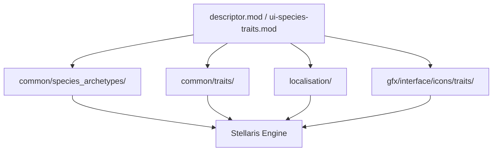
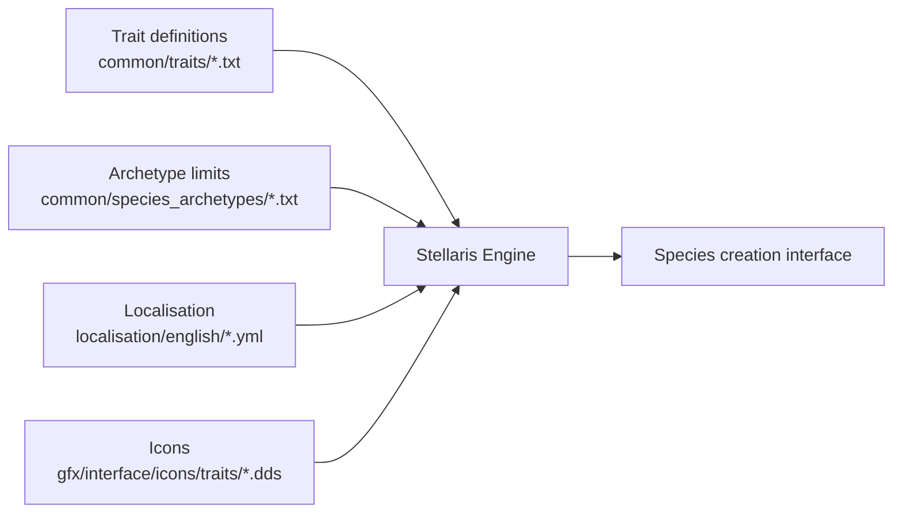

# Architecture

This document elaborates on the root [ARCHITECTURE.md](../ARCHITECTURE.md) with implementation-level detail for maintainers and contributors. It covers the declarative content architecture, the file contracts, and the integration boundaries with the Stellaris engine.

## Architectural style

The mod follows a **declarative, data-driven host-content** architecture. All content is expressed as static files interpreted by the Stellaris engine at load time:

- **Clausewitz script** (`.txt`) — trait definitions and archetype limits
- **YAML localisation** (`.yml`) — display names and descriptions
- **DDS images** (`.dds`) — trait icons

The mod supplies no executable code, scripts, or runtime services. The Stellaris engine is the sole runtime; the mod is a passive content package.

## Architectural areas

### Descriptor area

**Paths:**
- `ui-species-traits.mod` (repository root)
- `ui-species-traits/descriptor.mod` (mod directory root)

**Responsibilities:**
- Declare mod metadata: `version`, `name`, `path`, `tags`, and `supported_version`
- Provide the entry point for the launcher and the engine

**Boundary rules:**
- Must remain at the repository root and the mod directory root respectively
- Both descriptors declare identical values, and the release workflows rewrite `version` in both
- `supported_version` must match the targeted Stellaris branch; both currently declare `v4.5.*`
- Purely declarative; no executable logic

### Archetype area

**Paths:**
- `ui-species-traits/common/species_archetypes/00_species_archetypes.txt`

**Responsibilities:**
- Define trait points and maximum selectable traits per species archetype
- Raise the limits to two points and seven traits for `BIOLOGICAL` and `PRESAPIENT`, one point and seven traits for `MACHINE`, and zero points and six traits for `ROBOT`

**Boundary rules:**
- Uses the shared variables `@species_trait_points`, `@species_max_traits`, `@machine_trait_points`, `@machine_max_traits`, `@robot_trait_points`, and `@robot_max_traits`
- `LITHOID` inherits its limits from `BIOLOGICAL` via `inherit_trait_points_from`
- `PRESAPIENT` and `OTHER` declare `uses_modifiers = no`
- Archetypes constrain selection but never reference individual trait identifiers

### Trait definition area

**Paths:**
- `ui-species-traits/common/traits/ui-traits_species.txt` (38 definitions)
- `ui-species-traits/common/traits/ui-traits_species_newtiers.txt` (20 additional tiers)

**Responsibilities:**
- Define the 58 traits, including costs, opposites, allowed archetypes, and static modifiers
- Extend vanilla trait families with Very and Extremely tiers following the documented scaling policy

**Boundary rules:**
- Identifiers use the `ui_trait_*` prefix; additional tiers use `ui_trait_very_*` and `ui_trait_extremely_*`
- Every entry declares `cost`, `opposites`, `allowed_archetypes`, and a `modifier` block
- Entries in `ui-traits_species.txt` declare no `category`, `tags`, `ai_weight`, or `species_potential_add`; entries in `ui-traits_species_newtiers.txt` additionally declare `category`, `tags`, `slave_cost`, eligibility blocks, and, in some cases, `assembly_score` and `ai_weight`
- **No `icon` field exists in any trait definition** — icons resolve by filename convention
- `opposites` lists mutually exclusive identifiers from the mod and from vanilla
- `allowed_archetypes` restricts every trait to `BIOLOGICAL` alone or `BIOLOGICAL` and `LITHOID`; no trait declares `MACHINE` or `ROBOT`
- The scaling policy is recorded in file header comments and is not enforced by tooling

### Localisation area

**Paths:**
- `ui-species-traits/localisation/english/ui-species-traits_l_english.yml`
- `ui-species-traits/localisation/english/ui-species-traits_newtiers_l_english.yml`

**Responsibilities:**
- Provide `ui_trait_*:0` display names and `ui_trait_*_desc:0` descriptions for all 58 traits
- Style descriptions with `§L...§!` markers

**Boundary rules:**
- Keys must match trait identifiers exactly; a missing key renders the raw identifier
- Only English (`l_english`) is supplied
- The additional-tiers file carries a UTF-8 byte-order mark; the trait-definitions file does not. See [components/localisation.md](./components/localisation.md)

### Asset area

**Paths:**
- `ui-species-traits/gfx/interface/icons/traits/*.dds` (60 files)

**Responsibilities:**
- Provide an icon for every `ui_trait_*` identifier, plus two files inherited from earlier artwork (`trait_very_strong`, `trait_venerable`)
- Support the engine's filename-based icon resolution

**Boundary rules:**
- Format is DDS, as the engine requires; no runtime conversion occurs
- Filenames must match trait identifiers, because resolution is name-based
- No subdirectories; all icons reside directly in `traits/`

## Data architecture

The mod owns no mutable state. All content is static configuration consumed at startup.

| Data or Store | Owner | Representation and Storage | Lifecycle or Consistency |
|---------------|-------|----------------------------|--------------------------|
| Trait definitions | Trait definition area | Clausewitz script (`.txt`) in `common/traits/` | Static; parsed once per game start |
| Archetype limits | Archetype area | Clausewitz script (`.txt`) in `common/species_archetypes/` | Static; parsed once per game start |
| Localisation strings | Localisation area | YAML (`.yml`) in `localisation/english/` | Static; parsed once per game start |
| Trait icons | Asset area | DDS images in `gfx/interface/icons/traits/` | Static; resolved once per game start |
| Mod descriptors | Descriptor area | Clausewitz script (`.mod`) at the repository and mod roots | Static; read by the launcher and the engine |
| Trait selections | Stellaris engine | Save-game data | Engine-owned; requires the mod on load |

## Interfaces and integrations

| Interface | Direction | Contract | Owner | Failure semantics |
|-----------|-----------|----------|-------|-------------------|
| Mod descriptor | Engine → Mod | `descriptor.mod` / `ui-species-traits.mod` with `version`, `name`, `path`, `tags`, `supported_version` | Descriptor area | Mod not listed or version mismatch → mod disabled |
| Species archetypes | Engine → Mod | `common/species_archetypes/*.txt` defining trait points and maximum traits per archetype | Archetype area | Parse error → archetype defaults used |
| Trait definitions | Engine → Mod | `common/traits/*.txt` with `cost`, `opposites`, `allowed_archetypes`, `modifier` | Trait definition area | Parse error → trait omitted; missing icon → placeholder |
| Localisation | Engine → Mod | `localisation/english/*.yml` with `l_english` keys matching trait identifiers | Localisation area | Missing key → raw identifier displayed |
| Trait icons | Engine → Mod | `gfx/interface/icons/traits/*.dds` resolved as `GFX_trait_<identifier>` by filename | Asset area | Missing file → placeholder icon |

## Dependency direction and rules

- **Descriptor → All areas:** the mod descriptor is the root; it must exist for the mod to be recognised.
- **Trait definitions → Localisation:** every trait identifier in `common/traits/` must have a name key and a description key in `localisation/english/`.
- **Trait definitions → Assets:** every trait identifier must have a matching `.dds` file in `gfx/interface/icons/traits/`.
- **Archetype area → Trait definitions:** archetype limits constrain which traits are selectable but never reference specific identifiers.
- **No circular dependencies:** all dependencies flow from the engine to static mod files; the mod has no internal runtime dependencies.
- **Prohibited coupling:** trait definitions must not reference other mod files by path; cross-references use identifiers in `opposites` only.

## External dependencies

| Dependency | Version | Scope | Purpose |
|------------|---------|-------|---------|
| Stellaris game engine | `4.5.*` | Runtime | Parses all mod files; provides the species creation interface |
| Clausewitz script parser | Built into Stellaris | Load | Interprets `.txt` and `.mod` files |
| YAML parser | Built into Stellaris | Load | Interprets `.yml` localisation files |
| DDS image loader | Built into Stellaris | Load | Loads `.dds` trait icons |

No third-party libraries, package managers, or build tools are required. The mod is a content package.

## Deployment and operations

- **Process topology:** none. The mod is a static archive extracted into the Stellaris mod directory.
- **Deployment model:** manual extraction or platform-managed installation through the Steam Workshop, Nexus Mods, or Paradox Mods.
- **Persistent state:** none owned by the mod. Stellaris manages playset activation and save-game trait selections.
- **Scaling assumptions:** single-player and multiplayer with identical content on every client; no server component.
- **Operational consequences:** updates require re-extraction or a platform update, and a save created with these traits requires the mod to remain active.

## Compatibility contracts

| Contract | Owner | Invariant | Verification method | Change policy |
|----------|-------|-----------|---------------------|---------------|
| `supported_version` | Descriptor area | Must match the targeted Stellaris branch | Launcher validation at mod load | Update on a new Stellaris branch |
| Trait identifier ↔ localisation key | Trait definition and localisation areas | Every `ui_trait_*` identifier has `ui_trait_*:0` and `ui_trait_*_desc:0` | Manual inspection; the engine displays the raw identifier when a key is absent | Add both keys with every trait |
| Trait identifier ↔ icon file | Trait definition and asset areas | Every `ui_trait_*` identifier has a matching `.dds` file | Manual inspection; the engine displays a placeholder when the file is absent | Add the icon with every trait |
| Vanilla identifier references | Trait definition area | Identifiers named in `opposites` exist in the targeted game version | Manual inspection after each game update | Revalidate after every Stellaris release |
| Tier scaling policy | Trait definition area | Very tiers target 11/6 effects at triple cost; Extremely tiers add 20 per cent | Documented in file headers; not automated | Rebalance all affected tiers together |
| Archetype limits | Archetype area | `BIOLOGICAL` and `PRESAPIENT` use two points and seven traits; `MACHINE` one point and seven; `ROBOT` zero points and six | Engine enforcement in species creation | Adjust the shared variables |
| Archive layout | Release workflows | `ui-species-traits.mod` and `ui-species-traits/` remain at the archive root | Manual archive inspection | Preserve the layout in every packaging change |

## Testing and verification

- **No automated test suite exists.** Verification is manual:
  1. Extract the archive into the Stellaris mod directory and activate the mod in the launcher.
  2. Start Stellaris and open species creation.
  3. Confirm that all 58 traits appear with their names, descriptions, icons, costs, and modifiers.
  4. Confirm that the additional Very and Extremely tiers extend the expected vanilla families.
  5. Confirm the archetype limits: seven traits for `BIOLOGICAL`, `PRESAPIENT`, and `MACHINE`, and six for `ROBOT`.
  6. Confirm that `opposites` restrictions are enforced and that no placeholder icons appear.
  7. Inspect the Stellaris error log for parse failures, missing keys, or missing icons.
- **Material coverage gaps:** no automated regression testing and no continuous integration check for content.
- **Prohibitions:** do not commit unverified trait definitions, and do not reference vanilla identifiers in `opposites` without confirming that they exist in the targeted game version.

## Design constraints

- **Version coupling:** `supported_version="v4.5.*"` ties the mod to the 4.5 branch; a new branch requires descriptor updates and revalidation of every vanilla identifier reference.
- **Clausewitz script limitations:** trait entries are declarative literals; there is no conditional logic, loop, or computed value inside them.
- **Single language:** only English exists; another language requires a new locale directory and translated keys.
- **Icon format lock-in:** DDS is mandatory, and icons resolve by filename, so an identifier rename breaks the icon silently.
- **Archetype restriction:** every trait is limited to `BIOLOGICAL` alone or `BIOLOGICAL` and `LITHOID`, so neither `MACHINE` nor `ROBOT` species receive mod traits regardless of their trait points.
- **Engine-enforced limits:** trait points and maximum trait counts are applied per archetype and are unable to be exceeded by mod configuration alone.
- **No runtime modification:** content changes take effect only after a restart.
- **Convention-only balance:** the scaling policy is documentation; nothing validates it.

## Extension points

- **Trait definitions:** add an entry to `ui-traits_species.txt`, or a new file in `common/traits/`, then add the localisation keys and the icon.
- **Additional tiers for vanilla families:** add an entry to `ui-traits_species_newtiers.txt` following the documented scaling policy.
- **Additional archetype limits:** extend `00_species_archetypes.txt`; this is rarely required.
- **Additional languages:** create `localisation/<locale>/` with translated files that retain every key unchanged.
- **Icon replacement:** replace a `.dds` file in `gfx/interface/icons/traits/`, keeping the filename.

Integration location: all extensions are additive file placements inside the existing directory structure; no registration or composition root modification is required.

## Source map

| Area | Repository-relative paths |
|------|---------------------------|
| Descriptor | `ui-species-traits.mod`, `ui-species-traits/descriptor.mod` |
| Archetype | `ui-species-traits/common/species_archetypes/00_species_archetypes.txt` |
| Trait definitions | `ui-species-traits/common/traits/ui-traits_species.txt`, `ui-species-traits/common/traits/ui-traits_species_newtiers.txt` |
| Localisation | `ui-species-traits/localisation/english/ui-species-traits_l_english.yml`, `ui-species-traits/localisation/english/ui-species-traits_newtiers_l_english.yml` |
| Assets | `ui-species-traits/gfx/interface/icons/traits/*.dds` |
| Source artwork | `src/trait.xcf` |
| Distribution | `.github/workflows/github-release.yml`, `.github/workflows/nexus-mods-release.yml`, `.github/workflows/steam-workshop-release.yml` |

## Related documentation

| Document | Scope |
|----------|-------|
| [Repository overview](./repository-overview.md) | Purpose, scope, entry points |
| [Repository structure](./repository-structure.md) | Source tree layout, module organisation |
| [Data model](./data-model.md) | Trait definition schema, scaling policy, trait catalogue |
| [Components](./components/) | Per-area detail |
| [Flows](./flows/) | End-to-end execution flows |
| Root [ARCHITECTURE.md](../ARCHITECTURE.md) | Architectural boundaries and contracts |
| Root [README.md](../README.md) | Project overview, installation, capabilities |
| Root [CONTRIBUTING.md](../CONTRIBUTING.md) | Contribution guidelines |
| [Trait Catalogue (Wiki)](https://github.com/hmlendea/stellaris-ui-species-traits/wiki/Traits) | Trait list with effects and costs |