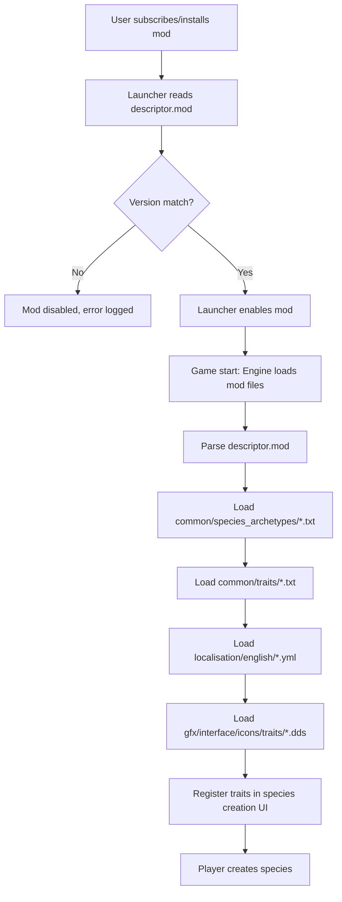

# Flow: Mod load

This document describes the end-to-end mod load flow from launcher activation to trait availability in species creation.

## Overview



## Step-by-step

### 1. Installation

| Method | Path |
|--------|------|
| Steam Workshop | `Steam/steamapps/workshop/content/281990/<workshop_id>/` |
| Nexus Mods | Manual extract to `Documents/Paradox Interactive/Stellaris/mod/` |
| Paradox Mods | `Documents/Paradox Interactive/Stellaris/mod/` |
| Manual | `Documents/Paradox Interactive/Stellaris/mod/ui-species-traits/` |

Mod package must contain:
- `ui-species-traits/` directory with all content
- `ui-species-traits.mod` descriptor at root

### 2. Launcher activation

1. User opens Stellaris launcher
2. Launcher scans `mod/` directory for `.mod` files
3. Reads `ui-species-traits.mod`:
   ```clausewitz
   name = "Universum Infinitum - Species Traits"
   path = "mod/ui-species-traits"
   tags = { "Species" "Traits" "Gameplay" }
   supported_version = "v4.5.*"
   ```
4. Launcher validates `supported_version` against current game version
5. If match: mod appears in mod list, user enables it
6. If mismatch: mod shows as incompatible, cannot enable

### 3. Game start — Engine load sequence

When Stellaris starts with mod enabled:

#### 3.1 Descriptor parsing
- Engine reads `ui-species-traits/descriptor.mod` (mod folder descriptor)
- Validates `path` points to existing directory
- Registers mod in internal mod list

#### 3.2 Archetype loading
- Engine loads `common/species_archetypes/00_species_archetypes.txt`
- Parses variable definitions (`@species_trait_points`, etc.)
- Registers each `species_archetype` block
- Applies `inherit_trait_points_from` resolution
- Stores trait points and max traits per archetype

#### 3.3 Trait definition loading
- Engine loads all `.txt` files in `common/traits/`:
  - `ui-traits_species.txt`
  - `ui-traits_species_newtiers.txt`
- For each trait block:
  - Validates required fields (`cost`, `category`, `opposites`, `allowed_archetypes`, `modifier`, `slave_cost`, `ai_weight`)
  - Registers trait ID, cost, category, opposites, allowed archetypes
  - Parses `modifier` block into static modifier list
  - Validates `opposites` trait IDs exist (vanilla + mod)
  - Validates `allowed_archetypes` are valid archetype names
- Failed parses: trait omitted, error logged to `error.log`

#### 3.4 Localisation loading
- Engine loads `localisation/english/ui-species-traits_l_english.yml`
- Engine loads `localisation/english/ui-species-traits_newtiers_l_english.yml`
- Parses `l_english:` keys
- Maps trait IDs to display names and descriptions
- Missing keys: raw ID used as fallback

#### 3.5 Icon loading
- Engine scans `gfx/interface/icons/traits/` for `.dds` files
- For each file `ui_trait_<name>.dds`, registers `GFX_trait_ui_trait_<name>`
- For each file `trait_<name>.dds`, registers `GFX_trait_trait_<name>`
- Missing icons: placeholder used, no error logged

### 4. Species creation UI population

When player opens species creation:

1. Engine determines species archetype (from portrait/empire type)
2. Retrieves `trait_points` and `max_traits` for that archetype
3. Filters all registered traits by `allowed_archetypes` containing the archetype
4. Displays traits in UI grouped by `category`
5. Shows trait name from localisation, icon from `GFX_trait_<id>`, cost, description
6. Enforces:
   - Max `max_traits` selections
   - Trait point budget (sum of `cost` ≤ `trait_points`)
   - `opposites` mutual exclusion

## Error handling

| Stage | Failure mode | Engine behaviour | Log location |
|-------|--------------|------------------|--------------|
| Launcher version check | `supported_version` mismatch | Mod disabled, not listed | Launcher log |
| Descriptor parse | Missing/invalid `.mod` | Mod not registered | `error.log` |
| Archetype parse | Syntax error | Archetype uses defaults | `error.log` |
| Trait parse | Missing required field | Trait omitted | `error.log` |
| Trait parse | Invalid `opposites` ID | Trait omitted | `error.log` |
| Localisation parse | UTF-8 BOM missing | File ignored, raw IDs shown | `error.log` |
| Icon load | Invalid DDS | Placeholder used | None |

## Verification commands

```bash
# Check mod loads without errors
# 1. Start Stellaris with -debug flag
# 2. Check Documents/Paradox Interactive/Stellaris/logs/error.log
# 3. Search for "ui_trait_" or "ui-species-traits"

# Verify trait registration
# In-game console (tilde key):
# > trait_list
# Lists all registered traits with IDs
```

## Related documentation

| Document | Scope |
|----------|-------|
| [Architecture](./architecture.md) | Interfaces, contracts |
| [Components/trait-definitions.md](../components/trait-definitions.md) | Trait fields validated at load |
| [Components/archetype-config.md](../components/archetype-config.md) | Archetype loading |
| [Components/localisation.md](../components/localisation.md) | Localisation loading |
| [Components/assets.md](../components/assets.md) | Icon loading |