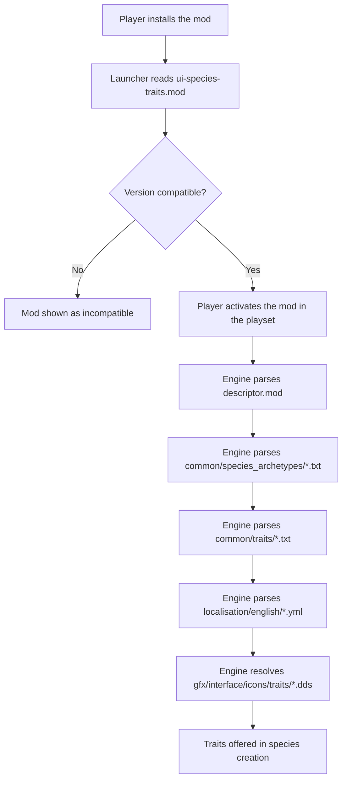

# Flow: Mod load

This document describes the mod load flow from launcher activation to trait availability in species creation.

## Overview

## Step-by-step

### 1. Installation

| Method | Location |
|--------|----------|
| Steam Workshop | Steam Workshop content directory for app `281990` |
| Nexus Mods | Extracted into the Stellaris `mod/` directory |
| Paradox Mods | Installed through the launcher |
| Manual | Extracted so that `ui-species-traits.mod` and `ui-species-traits/` sit directly in the Stellaris `mod/` directory |

The archive must contain the mod directory and the root descriptor side by side.

### 2. Launcher activation

1. The player opens the Stellaris launcher.
2. The launcher scans the `mod/` directory for `.mod` files.
3. It reads `ui-species-traits.mod`, which declares `version`, `name`, `path`, `tags`, and `supported_version`.
4. It evaluates `supported_version="v4.5.*"` against the installed game version.
5. A compatible mod appears in the playset and the player activates it; an incompatible mod is listed as such and is unable to be activated.

### 3. Engine load sequence

When Stellaris starts with the mod active:

#### 3.1 Descriptor parsing
- The engine reads `ui-species-traits/descriptor.mod`.
- It validates that `path` resolves inside the mod directory.
- It registers the mod in its internal list.

#### 3.2 Archetype loading
- The engine parses `common/species_archetypes/00_species_archetypes.txt`.
- It resolves the `@` variables and applies `inherit_trait_points_from` for `LITHOID`.
- It stores trait points and maximum traits per archetype.

#### 3.3 Trait definition loading
- The engine parses every `.txt` file under `common/traits/`, which currently means `ui-traits_species.txt` and `ui-traits_species_newtiers.txt`.
- For each block it registers the identifier, cost, opposites, allowed archetypes, and static modifiers.
- Traits in `ui-traits_species.txt` declare no `category`, `tags`, or eligibility blocks; the engine therefore relies on defaults for those.
- A block that fails to parse is omitted, and the failure is recorded in the error log.

#### 3.4 Localisation loading
- The engine parses both `.yml` files under `localisation/english/`.
- It maps each identifier to a name and a description.
- A missing key results in the raw identifier being displayed.

#### 3.5 Icon resolution
- The engine resolves icons by file name under `gfx/interface/icons/traits/`.
- The trait definition supplies no icon reference, so the file name alone determines which image appears.
- A missing file results in a placeholder image without a dedicated error entry.

### 4. Species creation population

When the player opens species creation:

1. The engine determines the archetype from the portrait and empire type.
2. It reads that archetype's trait points and maximum traits.
3. It filters every registered trait by `allowed_archetypes`.
4. It displays the remaining traits with their localised name, cost, and description, plus the resolved icon.
5. It enforces the trait point budget, the maximum trait count, and mutual exclusion through `opposites`.

Because no trait declares `MACHINE` or `ROBOT`, machine and robot species display only vanilla traits despite their raised limits.

## Error handling

| Stage | Failure mode | Engine conduct | Location |
|-------|--------------|----------------|----------|
| Launcher check | `supported_version` mismatch | Mod shown as incompatible | Launcher interface |
| Descriptor parse | Missing or invalid `.mod` | Mod not registered | Error log |
| Archetype parse | Syntax error | Archetype defaults retained | Error log |
| Trait parse | Invalid field or value | Trait omitted | Error log |
| Trait parse | Unknown identifier in `opposites` | Trait may be omitted or the exclusion ignored | Error log |
| Localisation parse | Malformed YAML | File ignored; raw identifiers displayed | Error log |
| Icon resolution | Missing or invalid DDS | Placeholder image | None |

## Verification

1. Start Stellaris with `-debug` and the mod active.
2. Open the error log in the Stellaris user directory and search for `ui_trait_` and `ui-species-traits`.
3. Open species creation and confirm that the traits appear with icons and descriptions.

## Related documentation

| Document | Scope |
|----------|-------|
| [Architecture](../architecture.md) | Interfaces, contracts |
| [Components/trait-definitions.md](../components/trait-definitions.md) | Fields parsed at load |
| [Components/archetype-config.md](../components/archetype-config.md) | Archetype loading |
| [Components/localisation.md](../components/localisation.md) | Localisation loading |