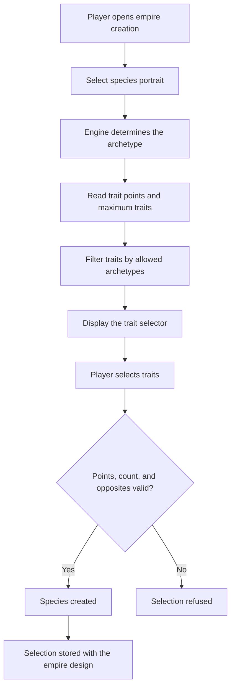

# Flow: Species creation

This document describes the species creation flow from interface interaction to trait selection and validation.

## Overview



## Step-by-step

### 1. Archetype determination

| Portrait or empire type | Archetype | Trait points | Maximum traits |
|-------------------------|-----------|--------------|----------------|
| Biological | `BIOLOGICAL` | 2 | 7 |
| Lithoid | `LITHOID` | 2 (inherited) | 7 (inherited) |
| Machine | `MACHINE` | 1 | 7 |
| Robot | `ROBOT` | 0 | 6 |
| Presapient | `PRESAPIENT` | 2 | 7 |
| Other | `OTHER` | not declared | not declared |

The archetype follows from the portrait and empire type rather than from a player choice, and the engine also supports vanilla archetypes that this file does not configure.

### 2. Trait filtering

The engine retains only traits whose `allowed_archetypes` contains the current archetype:

```clausewitz
ui_trait_brave = {
    cost = 2
    opposites = { "ui_trait_craven" }
    allowed_archetypes = { BIOLOGICAL LITHOID }
    modifier = {
        army_morale = 0.15
        army_damage_mult = 0.15
    }
}
```

Because every mod trait declares `BIOLOGICAL` alone or `BIOLOGICAL` and `LITHOID`, the mod traits available per archetype are:

| Archetype | Mod traits offered |
|-----------|--------------------|
| `BIOLOGICAL` | all 58 |
| `LITHOID` | all 58 |
| `PRESAPIENT` | all 58 |
| `MACHINE` | none |
| `ROBOT` | none |
| `OTHER` | none |

Machine and robot species still receive the raised trait points and maximum trait counts, but must spend them on vanilla traits. Presapient species declare `uses_modifiers = no`, so trait modifiers may not apply to them.

### 3. Trait selector

The selector displays each trait with its icon, localised name, cost, and description.

Traits appear grouped by the vanilla category they are assigned to: traits from `ui-traits_species.txt` declare no `category`, so the engine assigns them to a default group, whereas the additional tiers declare `category = normal`.

### 4. Selection mechanics

#### Trait point budget

- The starting budget is the archetype's trait points: 2 for `BIOLOGICAL`, `PRESAPIENT`, and `LITHOID`; 1 for `MACHINE`; 0 for `ROBOT`.
- A positive cost consumes points; a negative cost grants them.
- The running total is unable to fall below zero.

#### Maximum trait count

- The limit is the archetype's maximum traits: 7 for `BIOLOGICAL`, `PRESAPIENT`, `LITHOID`, and `MACHINE`; 6 for `ROBOT`.
- The count includes both positive and negative traits.

#### Mutual exclusion

Selecting a trait disables every identifier listed in its `opposites`, for example:

```clausewitz
ui_trait_craven = {
    cost = -2
    opposites = { "ui_trait_brave" }
    allowed_archetypes = { BIOLOGICAL LITHOID }
    modifier = {
        army_morale = -0.15
        army_damage_mult = -0.15
    }
}
```

Within a tier family the exclusion covers every member, so a species can hold at most one tier of a family. Because the lists are authored per entry, symmetry depends on the content rather than on the engine.

### 5. Validation

| Rule | Evaluation point | Result on failure |
|------|------------------|-------------------|
| Count within the maximum | Every selection | Selection refused |
| Point total not negative | Every selection | Selection refused |
| No opposed trait selected | Every selection | Conflicting trait disabled or selection refused |

### 6. Confirmation

On confirmation the engine stores the selected identifiers with the empire design. The traits continue to function only while the mod remains installed and active, and a later identifier change breaks an existing design's reference.

### 7. In-game effects

Once the species exists, the `modifier` blocks apply continuously through the engine's static modifier system. No script runs at runtime, and the save game stores identifiers rather than modifier values, so a modifier change in the mod affects existing saves on the next load.

## Example: biological species

Archetype `BIOLOGICAL` provides two trait points and seven trait slots.

```
Budget: 2 points, 7 traits

1. ui_trait_brave (cost 2)          -> budget 0, traits 1
2. ui_trait_extremely_agile (cost 8) -> refused: 0 - 8 would be negative
3. ui_trait_uncreative (cost -2)     -> budget 2, traits 2
4. ui_trait_very_undemanding (cost 3) -> budget -1 -> refused
5. ui_trait_optimistic (cost 1)      -> budget 1, traits 3
```

The final selection costs 2 + (-2) + 1 = 1 point and leaves one point unspent.

## Example: machine empire

Archetype `MACHINE` provides one trait point and seven trait slots, and offers no mod traits, so the player spends the point and the slots on vanilla machine traits only.

## Edge cases

| Scenario | Conduct |
|----------|---------|
| Mod disabled after a species is created | The stored identifiers no longer resolve and the traits are lost |
| Identifier renamed in an update | Existing saves and designs lose the trait |
| `cost` changed in an update | Existing species retain their design; new selections use the new values |
| `allowed_archetypes` changed | Existing species are unaffected; new selections use the new filter |
| `opposites` changed | Existing species are unaffected; new selections use the new exclusions |
| Icon file renamed | The trait remains valid and displays a placeholder |

## Related documentation

| Document | Scope |
|----------|-------|
| [Mod load flow](./mod-load.md) | Engine load sequence |
| [Trait selection flow](./trait-selection.md) | Selection detail and persistence |
| [Components/trait-definitions.md](../components/trait-definitions.md) | Fields used during selection |
| [Components/archetype-config.md](../components/archetype-config.md) | Archetype limits |