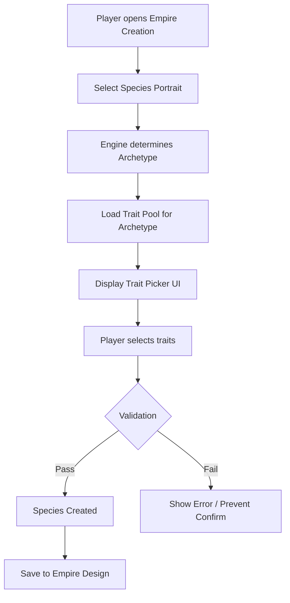

# Flow: Species creation

This document describes the species creation flow from UI interaction to trait selection and validation.

## Overview



## Step-by-step

### 1. Archetype determination

| Portrait type | Archetype | Trait points | Max traits |
|---------------|-----------|--------------|------------|
| Biological (humanoid, mammalian, etc.) | BIOLOGICAL | 2 | 7 |
| Lithoid (rock) | LITHOID | 2 | 7 |
| Machine (synthetic) | MACHINE | 1 | 7 |
| Robot (constructed) | ROBOT | 0 | 6 |
| Hovering | HOVERING | 1 | 7 |
| Psionic | PSIONIC | 2 | 7 |

Archetype is determined by the species portrait category, not player choice.

### 2. Trait pool filtering

Engine filters all registered traits (vanilla + mod) by `allowed_archetypes`:

```clausewitz
# Example trait definition
ui_trait_agile = {
    allowed_archetypes = { BIOLOGICAL LITHOID }
    ...
}
```

Only traits where `allowed_archetypes` contains the current archetype are shown.

**Mod trait availability by archetype:**

| Archetype | Available mod traits |
|-----------|---------------------|
| BIOLOGICAL | All 58 (38 custom + 20 tiers) |
| LITHOID | All 58 (38 custom + 20 tiers) |
| MACHINE | Industry traits only (~12) |
| ROBOT | Industry traits only (~12) |
| HOVERING | Industry traits only (~12) |
| PSIONIC | All 58 (inherits BIOLOGICAL) |

### 3. Trait picker UI

Traits displayed grouped by `category`:

| Category | UI Group | Example traits |
|----------|----------|----------------|
| `physical` | Physical | `ui_trait_strong`, `ui_trait_agile`, `ui_trait_very_strong` |
| `social` | Social | `ui_trait_creative`, `ui_trait_charismatic`, `ui_trait_trusting` |
| `biological` | Biological | `ui_trait_rapid_breeders`, `ui_trait_long_lived`, `ui_trait_adaptive` |
| `industry` | Industry | `ui_trait_natural_engineers`, `ui_trait_thrifty`, `ui_trait_very_natural_physicists` |
| `military` | Military | `ui_trait_brave`, `ui_trait_craven` |
| `leader` | Leader | (rarely used) |

Each trait shows:
- Icon (`GFX_trait_<id>`)
- Name (from localisation `ui_trait_<id>:0`)
- Cost (trait points)
- Description (from localisation `ui_trait_<id>_desc:0`, shown on hover)

### 4. Selection mechanics

#### Trait point budget

- Starting budget = archetype `trait_points` (2 for Biological, 1 for Machine, 0 for Robot)
- Positive traits cost points (e.g., `cost = 2`)
- Negative traits grant points (e.g., `cost = -2`)
- Running total must not exceed budget

#### Max trait count

- Hard limit = archetype `max_traits` (7 for Biological/Machine, 6 for Robot)
- Counts all selected traits (positive + negative)

#### Opposites enforcement

When player selects a trait, all traits in its `opposites` list are disabled:

```clausewitz
ui_trait_agile = {
    opposites = { trait_clumsy ui_trait_sluggish ui_trait_very_sluggish ui_trait_extremely_sluggish }
}
```

Selecting `ui_trait_agile` grays out `trait_clumsy`, `ui_trait_sluggish`, etc.

#### Tier mutual exclusion

Vanilla-extended tiers include all family members in `opposites`:

```clausewitz
ui_trait_very_strong = {
    opposites = { trait_weak trait_very_weak ui_trait_weak ui_trait_very_weak ui_trait_extremely_weak }
}
```

Player can only pick one tier per family (base, Very, or Extremely).

### 5. Validation rules

| Rule | Check point | Failure result |
|------|-------------|----------------|
| Trait count ≤ `max_traits` | On each selection | Prevent selection, show tooltip |
| Trait point sum ≤ `trait_points` | On each selection | Prevent selection, show tooltip |
| No opposites selected | On each selection | Auto-deselect opposite, or prevent |
| At least 1 trait (optional) | On confirm | Allow 0 traits (valid) |

### 6. Species creation confirmation

On "Create Empire" / "Save Species":

1. Engine validates all rules above
2. Serializes selected trait IDs to empire design
3. Stores in save game / empire template
4. Mod must remain enabled for traits to function in-game

### 7. In-game trait effects

Once species exists in-game:

- `modifier` blocks apply continuously via Stellaris static modifier system
- Effects: job output, growth speed, research speed, army stats, etc.
- No runtime script execution; all effects are declarative static modifiers
- Save game stores selected trait IDs; mod must be present on load

## Example: Biological species creation

```
Archetype: BIOLOGICAL (trait_points=2, max_traits=7)

Player selects:
1. ui_trait_very_strong (cost=6)  → Budget: 2-6 = -4 ❌ EXCEEDS
   → Engine prevents: "Not enough trait points"

Player selects:
1. ui_trait_strong (vanilla, cost=2)  → Budget: 2-2 = 0 ✓
2. ui_trait_agile (cost=2)  → Budget: 0-2 = -2 ❌ EXCEEDS
   → Engine prevents

Player selects:
1. ui_trait_strong (cost=2)  → Budget: 0
2. ui_trait_uncreative (cost=-2)  → Budget: 0-(-2) = 2 ✓
3. ui_trait_rapid_breeders (cost=2)  → Budget: 2-2 = 0 ✓
4. ui_trait_natural_engineers (cost=2)  → Budget: 0-2 = -2 ❌ EXCEEDS

Final valid selection (3 traits, 0 points remaining):
- trait_strong (vanilla)
- ui_trait_uncreative (custom negative)
- trait_rapid_breeders (vanilla)
```

## Example: Machine species creation

```
Archetype: MACHINE (trait_points=1, max_traits=7)

Available mod traits (industry category only):
- ui_trait_natural_engineers (cost=2) → too expensive
- ui_trait_very_natural_engineers (cost=6) → too expensive
- ui_trait_extremely_natural_engineers (cost=8) → too expensive
- ui_trait_poor_engineers (cost=-2) → grants points
- ui_trait_very_poor_engineers (cost=-6) → grants points
- ui_trait_extremely_poor_engineers (cost=-8) → grants points
- ui_trait_natural_physicists (cost=2) → too expensive
- ui_trait_very_natural_physicists (cost=6) → too expensive
- ui_trait_extremely_natural_physicists (cost=8) → too expensive
- ui_trait_poor_physicists (cost=-2) → grants points
- ui_trait_very_poor_physicists (cost=-6) → grants points
- ui_trait_extremely_poor_physicists (cost=-8) → grants points
- ui_trait_natural_sociologists (cost=2) → too expensive
- ui_trait_very_natural_sociologists (cost=6) → too expensive
- ui_trait_extremely_natural_sociologists (cost=8) → too expensive
- ui_trait_poor_sociologists (cost=-2) → grants points
- ui_trait_very_poor_sociologists (cost=-6) → grants points
- ui_trait_extremely_poor_sociologists (cost=-8) → grants points

With 1 trait point, Machine can only pick negative industry traits
or vanilla machine traits (cost 1).
```

## Edge cases

| Scenario | Behaviour |
|----------|-----------|
| Mod disabled after species creation | Traits show as missing, species may be invalid |
| Mod updated, trait IDs changed | Save game references old IDs → missing traits |
| Trait `cost` changed in mod update | Existing species retain old costs; new species use new costs |
| `allowed_archetypes` changed | Existing species unaffected; new species use new filter |
| `opposites` changed | Existing species unaffected; new species use new opposites |

## Related documentation

| Document | Scope |
|----------|-------|
| [Mod load flow](./mod-load.md) | Engine load sequence |
| [Components/trait-definitions.md](../components/trait-definitions.md) | Trait fields used in selection |
| [Components/archetype-config.md](../components/archetype-config.md) | Archetype limits |
| [Data model](../data-model.md) | Scaling policy, trait catalogue |