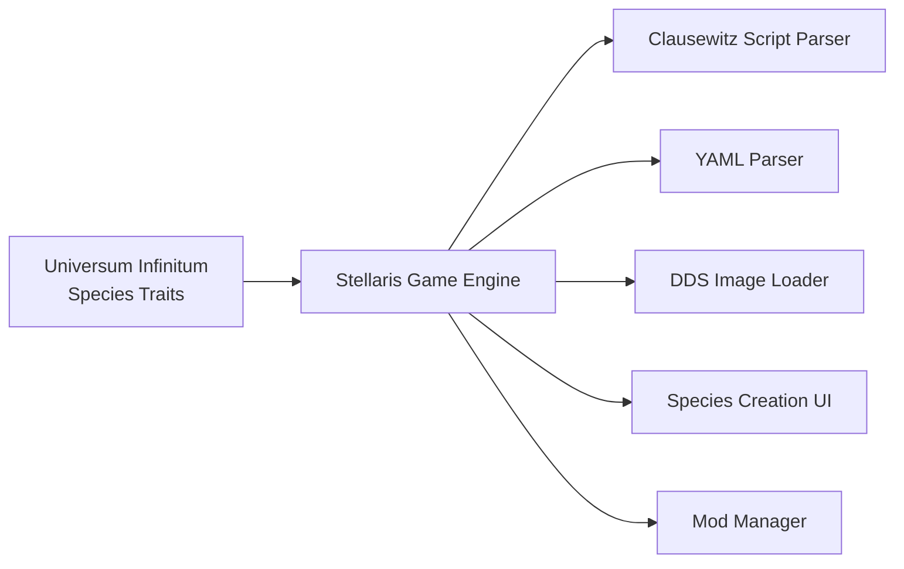

# Dependencies

This document describes the external dependencies, version coupling, and compatibility requirements for the Universum Infinitum - Species Traits mod.

## Dependency overview

The mod has **no third-party libraries, package managers, or build tools**. All dependencies are provided by the Stellaris game engine itself.



## Runtime dependencies

| Dependency | Version | Scope | Purpose | Provider |
|------------|---------|-------|---------|----------|
| Stellaris Game Engine | `4.4.*` / `4.5.*` | Runtime | Parses all mod files; provides species creation UI | Paradox Interactive |
| Clausewitz Script Parser | Built into Stellaris | Load | Interprets `.txt` and `.mod` files | Paradox Interactive |
| YAML Parser | Built into Stellaris | Load | Interprets `.yml` localisation files | Paradox Interactive |
| DDS Image Loader | Built into Stellaris | Load | Loads `.dds` trait icons | Paradox Interactive |

## Version coupling

### Supported version declaration

Both descriptor files declare:

```clausewitz
supported_version = "v4.5.*"
```

This couples the mod to Stellaris 4.5.x. The launcher enforces this at mod activation.

### Version mismatch behaviour

| Game version | Mod behaviour |
|--------------|---------------|
| 4.5.x | ✅ Enabled, fully functional |
| 4.4.x | ⚠️ May work (README states 4.4.*), but descriptor says 4.5.* |
| 4.6.x | ❌ Disabled by launcher (version mismatch) |
| 3.x | ❌ Disabled by launcher |

### Version update triggers

| Trigger | Required action |
|---------|-----------------|
| Stellaris 4.6 release | Update `supported_version` to `v4.6.*`, verify traits, test, release |
| Stellaris 4.5.x patch | No action (wildcard covers patches) |
| Trait modifier renamed in engine | Update trait definitions, test, release |
| New archetype added by DLC | Add to `allowed_archetypes` if applicable |

## Compatibility matrix

| Component | Vanilla Stellaris | UI Species Traits Mod | Notes |
|-----------|-------------------|----------------------|-------|
| Trait definitions | `common/traits/*.txt` | `common/traits/ui-traits_*.txt` | Additive; no vanilla file modification |
| Archetype config | `common/species_archetypes/*.txt` | `common/species_archetypes/00_species_archetypes.txt` | Overrides vanilla limits |
| Localisation | `localisation/english/*.yml` | `localisation/english/ui-species-traits_*.yml` | Additive; new keys only |
| Icons | `gfx/interface/icons/traits/*.dds` | `gfx/interface/icons/traits/*.dds` | Additive; new files only |

### Overlap risk

| Risk | Severity | Mitigation |
|------|----------|------------|
| Trait ID collision with vanilla | Low | All mod traits use `ui_trait_` prefix |
| Trait ID collision with other mods | Medium | `ui_trait_` prefix is mod-specific; other mods unlikely to use |
| Archetype override conflict | Medium | `00_species_archetypes.txt` loads first (numeric prefix); other mods may override |
| Localisation key collision | Low | Keys use `ui_trait_` prefix |
| Icon filename collision | Low | Filenames use `ui_trait_` prefix |

## DLC dependencies

| DLC | Required? | Impact |
|-----|-----------|--------|
| Base game | Yes | Mod requires Stellaris |
| Species Pack | No | No dependency |
| Lithoids Species Pack | No | LITHOID archetype exists in base game |
| Machine Intelligence Pack | No | MACHINE/ROBOT archetypes exist in base game |
| Aquatics Species Pack | No | No dependency |
| Overlord | No | No dependency |
| Toxoids Species Pack | No | No dependency |
| First Contact Story Pack | No | No dependency |
| Distant Stars Story Pack | No | No dependency |
| Leviathans | No | No dependency |
| Federations | No | No dependency |
| Nemesis | No | No dependency |
| Synthetic Dawn Story Pack | No | No dependency |
| Apocalypse | No | No dependency |
| Utopia | No | No dependency |

The mod works with the base game only. DLC content is not referenced.

## Platform dependencies

| Platform | Supported | Notes |
|----------|-----------|-------|
| Windows | ✅ | Primary platform |
| macOS | ✅ | Same mod files |
| Linux | ✅ | Same mod files |
| Steam Deck | ✅ | Linux-based; same mod files |
| Console | ❌ | Stellaris console does not support mods |

## Distribution platform dependencies

| Platform | Workflow | Status |
|----------|----------|--------|
| Steam Workshop | `.github/workflows/steam-workshop.yml` | Automated |
| Nexus Mods | `.github/workflows/nexus-mods.yml` | Automated |
| Paradox Mods | Manual upload | Manual |
| GitHub Releases | Manual or via `gh release create` | Manual |

## Development dependencies

| Tool | Purpose | Required? |
|------|---------|-----------|
| GIMP | Icon editing (`src/trait.xcf`) | Optional (for icon creation) |
| DDS plugin for GIMP | DDS export | Optional (for icon creation) |
| Text editor | Editing `.txt` and `.yml` files | Yes |
| Git | Version control | Yes |
| Stellaris | Testing | Yes |

No build tools, compilers, or package managers are required.

## File format dependencies

| Format | Used for | Parser |
|--------|----------|--------|
| Clausewitz script (`.txt`, `.mod`) | Trait definitions, archetype config, descriptors | Stellaris engine |
| YAML (`.yml`) | Localisation | Stellaris engine |
| DDS (`.dds`) | Trait icons | Stellaris engine |
| GIMP (`.xcf`) | Icon source assets | GIMP (development only) |

## Security considerations

- No network calls, no external data fetching
- No executable code, no script execution
- No user data collection
- Mod files are read-only at runtime
- Save game compatibility: mod must remain enabled for traits to function

## Related documentation

| Document | Scope |
|----------|-------|
| [Configuration](./configuration.md) | Descriptor fields, supported_version |
| [Build and deployment](./build-and-deployment.md) | Distribution workflows |
| [Architecture](../architecture.md) | External dependencies table |
| Root [README.md](../README.md) | Installation, system requirements |